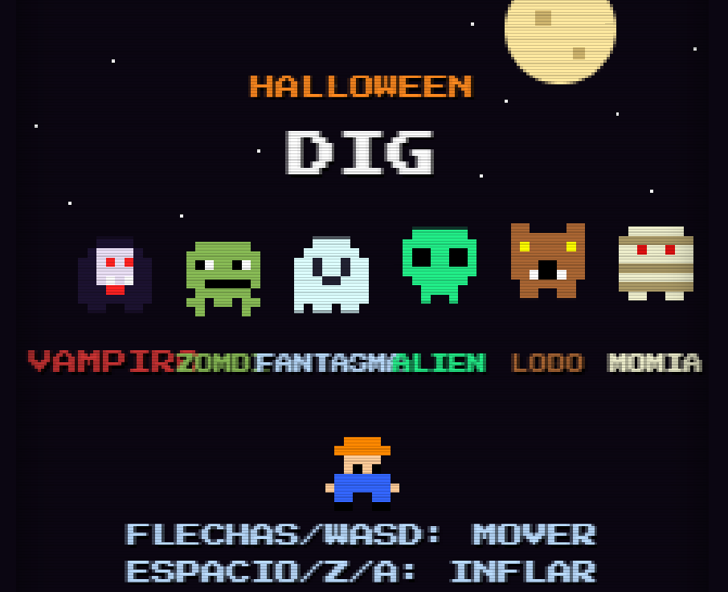

# 🎃 Halloween Dig

Videojuego retro de Halloween en pixel art, inspirado en los arcades de 8 bits. Cava túneles bajo tierra e **infla vampiros, zombis, fantasmas, aliens, hombres lobo y momias** hasta que exploten.

Hecho con HTML, CSS y JavaScript puro: **un solo archivo, sin dependencias ni instalación**. Los sonidos y la música se generan en tiempo real con la Web Audio API.

👉 Jugar ahora: https://pablo-profetechmike.github.io/Halloween-Dig/



## ✨ Características

- 🧛🧟👻👽🐺🪦 Seis monstruos con sprites en pixel art
- ⛏️ Túneles que se cavan en tiempo real y bomba de inflado con 4 niveles
- 👻 Los monstruos se vuelven fantasma y atraviesan la tierra para perseguirte
- 💥 Partículas, temblor de pantalla, puntos flotantes, murciélagos, luna y lápidas animadas
- 🔊 Efectos de sonido y música de fondo en 8 bits, sin archivos de audio
- 📈 Niveles con dificultad creciente y récord guardado en el navegador
- 📺 Efecto de pantalla CRT

## 🎮 Controles

| Dispositivo | Moverse | Inflar |
|---|---|---|
| Teclado (PC y Mac) | Flechas o `W` `A` `S` `D` | `Espacio`, `Z` o `X` |
| Mando (gamepad) | Cruz o stick izquierdo | `A`, `B`, `X`, `Y`, `R1` o `R2` |
| Celular, tablet e iPad | Cruz táctil en pantalla | Botón 💨 |

`M` activa o desactiva el sonido. `Enter` o `Start` inician la partida.

> Si el mando no se detecta, pulsa cualquier botón una vez: los navegadores lo activan así.

## 🕹️ Cómo se juega

1. Muévete y cava túneles para llegar a los monstruos.
2. Dispara la bomba hacia ellos y pulsa varias veces para inflarlos (4 bombeos y explotan).
3. Cuanto más profundo esté el monstruo, más puntos ganas.
4. Cuidado: los monstruos que no están inflados te hacen perder una vida.
5. Elimina a todos para pasar al siguiente nivel.

## 🚀 Ejecutar en local

```bash
git clone https://github.com/Pablo-ProfeTechMike/Halloween-Dig.git
cd halloween-dig
# abre index.html en tu navegador, o sirve la carpeta:
python3 -m http.server 8000
```

## 🌐 Publicar en GitHub Pages

1. Sube `index.html` a la rama `main`.
2. Ve a **Settings → Pages**.
3. En *Source* elige **Deploy from a branch**, rama `main`, carpeta `/ (root)`.
4. Tu juego quedará en `https://github.com/Pablo-ProfeTechMike/Halloween-Dig`.

## 🧱 Estructura

```
halloween-dig/
├── index.html   # todo el juego (HTML + CSS + JS)
├── README.md
└── LICENSE
```

## 🛠️ Tecnología

- Canvas 2D (224×256, escalado con `image-rendering: pixelated`)
- Web Audio API (osciladores y ruido)
- Gamepad API
- Eventos de puntero para el control táctil
- Bucle de juego con paso de tiempo fijo (60 Hz)

## 🗺️ Ideas para el futuro

- [ ] Lápidas que caen y aplastan monstruos
- [ ] Calabazas de bonus
- [ ] Jefes de nivel
- [ ] Tabla de récords en línea
- [ ] Modo para dos jugadores

## 🤝 Contribuir

Los *issues* y *pull requests* son bienvenidos. Si encuentras un fallo con algún mando o dispositivo, abre un issue indicando el modelo y el navegador.

## 📄 Licencia

[MIT](LICENSE). Úsalo, modifícalo y compártelo libremente.

---

Hecho con 🧡 y mucha magia de Halloween. Creado con ayuda de [Claude](https://claude.ai).
